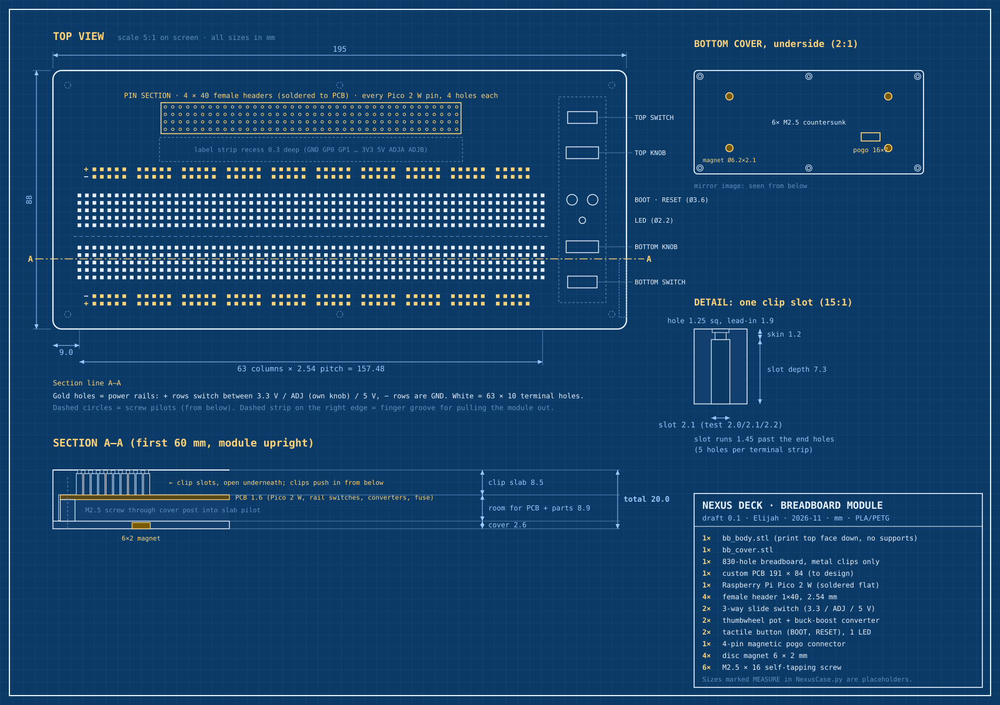

# NEXUS hardware

Everything physical: the OptiPlex used for testing now, the cyberdeck's parts, how to choose the deck board, the breadboard module, the Pico lid sensor and the 3D-printed case.

Status key: ✅ have it · 🛒 to buy · 📐 being designed · ❓ not decided

## 1. Test machine: Dell OptiPlex 3060 SFF ✅

| | |
| --- | --- |
| CPU | Intel Core i3/i5 8th gen (Coffee Lake), 64-bit x86 |
| Graphics | Intel UHD 630 (built in; good Hyprland support through Mesa) |
| Firmware | UEFI. F12 at power-on = boot menu, F2 = setup |
| NEXUS board name | `BOARD=uefi-x86` in `config/board.conf` |
| Role | The only machine that can test NEXUS OS until the deck exists (phases 1–4) |

Install steps: [INSTALL-OPTIPLEX.md](INSTALL-OPTIPLEX.md). If it won't boot from USB, turn **Secure Boot** off in setup (F2 › Secure Boot).

## 2. The cyberdeck

### 2.1 Parts list

| Part | Choice | Status | Notes |
| --- | --- | --- | --- |
| Board | See [§ 3](#3-choosing-the-deck-board) | ❓ | Decided before phase 5 |
| Screen | Waveshare 7" HDMI LCD (H), 1024×600, capacitive touch | ✅/🛒 | HDMI for picture, USB for touch and power |
| Keyboard | Custom 40 % keyboard | 📐 | USB; shows up as a normal keyboard |
| Pointer | Trackball + two buttons | 📐 | USB mouse |
| Controllers | 8BitDo Zero 2 (×2) in slide-in trays | 🛒 | Bluetooth; trays just hold them |
| Breadboard module | Custom, see [§ 4](#4-breadboard-module) | 📐 | Takes both slots |
| Lid / battery sensor | Raspberry Pi Pico + hall sensor + divider, see [§ 5](#5-pico-lid-and-battery-sensor) | ✅ code ready | Firmware in `pico/lid-sensor/` |
| Storage | eMMC or NVMe for the OS (board-dependent) + micro SD for games, files and AI models | 🛒 | |
| Battery | ❓ (size the pack once the board is chosen) | ❓ | Needs a charger board with a CHRG pin if possible |
| USB hub | Small internal hub feeding the two module slots and the Pico | 🛒 | |
| Case | Self-designed, 3D-printed on the Bambu Lab A1, see [§ 6](#6-case) | 📐 draft 0.1 | |

### 2.2 How it all connects

```
                       ┌──────────── deck board ────────────┐
 Waveshare 7" ◄─ HDMI ─┤                                     │
             ── USB ──►┤ touch                               │
 40% keyboard ─ USB ──►┤                                     │
 trackball ──── USB ──►┤                                     │
 Pico (lid) ─── USB ──►┤                                     ├── Wi-Fi / Bluetooth ◄── 8BitDo controllers
 USB hub ────── USB ──►┤                                     │
   ├─ slot A pogo      │                                     │
   └─ slot B pogo      │                                     │
 micro SD ────────────►┤                                     │
 battery ─ charger ───►┤ power                               │
                       └─────────────────────────────────────┘
```

## 3. Choosing the deck board

This is the biggest open hardware decision. It blocks phase 5. It must be made (and the board bought) before phase 5 starts.

### 3.1 What the board must do

| Need | Why | Minimum |
| --- | --- | --- |
| Run Hyprland smoothly at 1024×600 | The whole point of NEXUS | A GPU with a good open-source Mesa driver |
| Armbian support | NEXUS is built with Armbian | Board listed as supported (or community-maintained with a working `current` kernel) |
| **Offline AI** (Elijah's choice) | Iris must work with no internet | Runs a 1–3 billion parameter model at **5+ words a second** |
| RAM | Desktop + browser + AI model at once | **8 GB** (16 GB is better with AI) |
| Wi-Fi + Bluetooth | Network, controllers | Built in, or a small USB adapter |
| USB | Keyboard, trackball, touch, Pico, hub | 3+ ports, or one hub |
| Power | Battery life | As low as the AI need allows |
| Size | Must fit the case | Credit-card size or a little bigger |

### 3.2 The candidates

AI speeds below are from public benchmarks people have posted (gathered November 2026). They are rough: speed changes with the model, the software version and cooling. "t/s" means tokens per second; one token is roughly three quarters of a word.

| Board | AI chip | AI speed (small models) | RAM | Notes |
| --- | --- | --- | --- | --- |
| **RK3588 board** (Radxa Rock 5B/5C, Orange Pi 5, …) | Built-in NPU, about 6 TOPS | NPU (RKLLM): Qwen 1.8B ~14 t/s, TinyLlama 1.1B ~15 t/s, Phi-3 3.8B ~6.5 t/s, DeepSeek-R1-Distill 1.5B ~15 t/s. CPU (llama.cpp): Qwen2.5 1.5B ~22 t/s | 8/16/32 GB | Strongest CPU and GPU of the options; Mali-G610 GPU with the open Panthor driver. Runs warmer and draws more power |
| **Raspberry Pi 5 (8 GB)** | None (CPU only) | llama.cpp: Llama 3.2 1B ~11 t/s, Qwen2.5 3B ~5 t/s | 8/16 GB | Best software support and documentation. Needs active cooling for AI |
| **Raspberry Pi 5 + AI HAT+ 2** | Hailo-10H, 40 TOPS (INT4), its own 8 GB RAM | ~6.5 t/s reported for 1.5B models; supported models so far include Llama 3.2 1B, Qwen2 1.5B and DeepSeek-R1-Distill 1.5B | 8 + 8 GB | The HAT costs about US$200. Its own memory leaves the Pi's RAM free for the desktop. Smaller choice of models |
| **Raspberry Pi 4** | None | Too slow for usable chat | up to 8 GB | Older, weaker GPU. Not recommended any more |
| **Radxa Zero 3W** (RK3566) | Small NPU, **not supported by RKLLM** | CPU only, tiny models only | up to 8 GB | Smallest and lowest power, but can't meet the offline AI need |

### 3.3 Recommendation

1. **First choice: an RK3588 board with 16 GB** (for example a Radxa Rock 5C or Orange Pi 5). Fastest local AI by a wide margin, smoothest desktop, room for the browser and a model at once.
2. **Second choice: Raspberry Pi 5 with 8 or 16 GB.** Easiest to get running and the best-supported; AI is usable with 1B models on the CPU. The AI HAT+ 2 can be added later if more speed is wanted.
3. **Not suitable for offline AI:** Radxa Zero 3W and Pi 4.

Check before buying:

- [ ] Board is on Armbian's supported list, with a `current` (mainline) kernel image.
- [ ] Display over HDMI works at 1024×600 (most do; some need a custom mode line, which goes in the board file).
- [ ] Physical size fits the case's board bay (the case is redesigned around it in phase 6).
- [ ] Power draw under load, to size the battery.
- [ ] Cooling: a small heatsink and fan fit in the case.

The decision gets recorded in [DECISIONS.md](DECISIONS.md) and in `SPEC.md`.

## 4. Breadboard module

📐 Case designed (draft 0.1); circuit board not designed yet.

A double-width module that fills both controller slots. It turns the deck into a portable electronics bench.



### 4.1 Layout

```
 ┌───────────────────────────────────────────────────────────────────── 195 mm ─┐
 │ + ━━━━━━━━━━━━━━━━━━━━━━━━━━━━━━━━━━━━━━━━━━━━━━━━━━━━━━ (top rail)   │ ○ SW │
 │ − ━━━━━━━━━━━━━━━━━━━━━━━━━━━━━━━━━━━━━━━━━━━━━━━━━━━━━━   GND        │ ◎ ADJ│
 │   ┆┆┆┆┆┆┆┆┆┆┆┆┆┆┆┆┆┆┆┆┆┆┆┆┆┆┆┆┆┆┆┆┆┆┆┆┆┆┆┆┆┆┆┆┆┆┆┆┆┆┆┆┆┆┆┆┆┆┆┆┆┆┆   │      │
 │   ┆ 63 columns × 5 holes, a–e                                        │      │ 88
 │   ═══════════════════ centre gap ═════════════════════════════════  │ BOOT │ mm
 │   ┆ 63 columns × 5 holes, f–j                                        │ RESET│
 │ − ━━━━━━━━━━━━━━━━━━━━━━━━━━━━━━━━━━━━━━━━━━━━━━━━━━━━━━   GND        │ ○ SW │
 │ + ━━━━━━━━━━━━━━━━━━━━━━━━━━━━━━━━━━━━━━━━━━━━━━━━━━━━━━ (bottom rail)│ ◎ ADJ│
 │ ▤▤▤▤▤▤▤▤▤▤▤▤▤▤▤▤▤▤▤▤▤▤▤▤▤▤▤▤▤▤▤▤▤▤▤▤▤▤▤▤  pin section: 40 pins × 4 holes   │
 └──────────────────────────────────────────────────────────────────────────────┘
```

| Part | Detail |
| --- | --- |
| Breadboard | Full size, 830 holes: 63 columns × 10 rows plus 4 power rails. Metal clips harvested from a bought breadboard, pushed into slots in the printed body |
| Pin section | 40 labelled strips of 4 connected holes (4 × 40 precision female headers soldered to the PCB), one per Pico pin: 26 GPIO, GND (×8), 3V3 (×2), 5V (×2), ADJ A, ADJ B, RUN |
| Microcontroller | Raspberry Pi Pico 2 W, soldered flat on the module PCB. Its USB comes from the test pads underneath and goes to the pogo connector, so the deck sees a normal Pico |
| Power rails | Minus strips are always GND. Each plus strip has its own 3-way switch **3.3V / ADJ / 5V** and its own knob. In ADJ, that rail follows its own knob (one buck-boost converter per rail, about 1.2–5.5 V). The two rails can be two different custom voltages at once |
| Helper chip | Separate small microcontroller: electronic fuse, rail on/off and a voltage + current sensor per rail. Keeps working when the Pico is being reflashed or has crashed. Reports to the deck over USB |
| Buttons | BOOT and RESET on the module edge |
| Connection | 4-pin magnetic pogo connector: 5V, GND, USB D+, USB D−, to the deck's USB hub |
| Held by | 4 magnets (6 × 2 mm discs) and the bay walls |

### 4.2 Printed body (draft 0.1)

| Size | Value |
| --- | --- |
| Module | 195 × 88 × 20 mm (fits both slots) |
| Top slab (holds clips) | 8.5 mm thick, 1.2 mm skin above the clips |
| Room underneath for the PCB | 8.9 mm |
| Bottom cover | 2.6 mm |
| Hole pitch / size | 2.54 mm / 1.25 mm square (with a 1.9 mm lead-in) |
| Clip slot width | 2.1 mm (to be confirmed with the test piece: 2.0 / 2.1 / 2.2) |
| Clip slot depth | 7.3 mm |
| Screws | 6 × M2.5 × 16 mm self-tapping |
| Pogo opening | 16 × 7 mm |

**Print the clip test piece first** (`docs/hardware/case/stl/clip_test.stl`, about 15 minutes). Push harvested clips in from the open side: one notch on the edge = 2.0 mm slots, two = 2.1 mm, three = 2.2 mm. Report which width grips the clips and whether jumper wires go in and hold. That number is set in the Fusion script (`slot_w`) before printing the full module.

### 4.3 Still to design (needed for phase 6.7)

- [ ] Module PCB (KiCad): Pico 2 W footprint, header strips, two buck-boost converters, two 3-way switches, two potentiometers, helper chip, fuses, pogo connector.
- [ ] Part numbers: switch, knob/potentiometer, buck-boost converter, current sensor, e-fuse, pogo connector.
- [ ] Helper-chip firmware (reports rail voltage/current over USB, takes on/off commands).
- [ ] Current limit per rail (suggestion: 500 mA, to protect the deck's battery and USB hub).

## 5. Pico lid and battery sensor

✅ Firmware written (`pico/lid-sensor/main.py`), 🛒 parts to wire.

A Raspberry Pi Pico (or Pico W) on the deck's USB tells NEXUS when the lid closes and how full the battery is. (Many deck boards have GPIO pins that could do this, but the Pico keeps it board-independent.)

| Pico pin | Connects to |
| --- | --- |
| GP15 (pin 20) | Hall sensor output (A3144 or DRV5032). A magnet in the lid pulls it low when closed |
| 3V3 (pin 36) | Hall sensor power |
| GND (pin 38) | Hall sensor GND and battery minus |
| GP26 / ADC0 (pin 31) | Middle of a divider from battery plus: 100 kΩ battery+ → GP26, 100 kΩ GP26 → GND |
| GP14 (pin 19) | Optional: charger board's CHRG pin (low while charging) |

The divider halves the battery voltage so GP26 stays under 3.3 V (`DIVIDER_RATIO = 2.0` in `main.py`). For a 2-cell pack, use a bigger divider. Full notes and flashing steps: [`pico/lid-sensor/README.md`](../pico/lid-sensor/README.md). (That README still mentions the old Settings app; it gets updated in phase 6.4.)

## 6. Case

📐 Draft 0.1, designed as a Fusion 360 script. **Only the clip test piece, the breadboard module and the controller trays are ready to print.** The deck parts are placeholders until the real parts are measured.

### 6.1 Files

All in [`docs/hardware/case/`](hardware/case/):

| File | What |
| --- | --- |
| `fusion/NexusCase/NexusCase.py` | The Fusion 360 script that builds every part. All sizes are in the `P` table at the top |
| `stl/*.stl` | Ready-to-print parts made by the script |
| `module_labels.svg` | Label stickers for the module (print at 100 %) |
| `images/` | Previews and the module blueprint |
| `PRINT-NOTES.txt` | Print settings for each part |

**Using the script in Fusion 360:** Utilities › Add-Ins › Scripts and Add-Ins › the green **+** next to "My Scripts" › choose the `NexusCase` folder › select it › **Run**. It builds each part as its own component. Change a number in `P`, run again.

### 6.2 Deck size (draft)

| | |
| --- | --- |
| Footprint | 250 × 218.5 mm |
| Closed thickness | 51 mm |
| Base tub height | 30.6 mm |
| Lid thickness | 18 mm (set by the screen's depth) |
| Hinge | One M3 × 30 bolt + lock nut per side |
| Module bay | Two slots side by side along the hinge edge, 0.4 mm clearance |

### 6.3 Parts and print settings

| Part | Ready? | Print |
| --- | --- | --- |
| `clip_test.stl` | ✅ | Flat, no supports, ~15 min |
| `bb_body.stl` | ✅ (after the clip test) | Top face on the bed (already flipped). 0.2 mm nozzle best; with 0.4 mm use Arachne walls. 0.12–0.16 mm layers, no supports |
| `bb_cover.stl` | ✅ | Flat side down. Glue 4 magnets into the pockets |
| `controller_tray.stl` | ✅ | Print two. Pocket for an 8BitDo Zero 2 plus a jumper-wire bin |
| `deck_base.stl`, `module_bay.stl`, `deck_plate.stl`, `lid_bezel.stl`, `lid_back.stl` | ❌ draft | Don't print until measured |

### 6.4 Measurements needed before the deck can be printed

- [ ] Keyboard opening (placeholder 229.6 × 96.25 mm) and support post height (19 mm)
- [ ] Trackball opening (30 mm) and the two button openings
- [ ] Screen's visible window (156 × 88 mm) and depth (sets the 18 mm lid)
- [ ] Deck board size, mounting holes and port positions (after the board decision)
- [ ] Port openings in the left wall, power button in the right wall
- [ ] Battery size
- [ ] Pogo connector size (16 × 7 mm placeholder)

## 7. Power budget (to fill in during phase 5)

| Part | Typical | Peak |
| --- | --- | --- |
| Deck board | ? | ? |
| Screen | ~2.5 W | |
| Keyboard, trackball, Pico | < 0.5 W | |
| Breadboard module (rails) | 0 | up to 2 × 500 mA at up to 5.5 V |
| **Total** | ? | ? |

Battery capacity needed (Wh) = total typical watts × hours wanted. Measure with a USB power meter once the board arrives.
